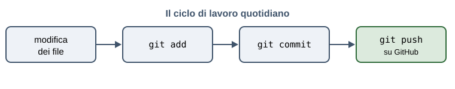

# Appunti sul ciclo di lavoro con Git

Documento scritto in laboratorio durante la prima lezione del modulo M1.
Raccoglie i comandi visti nel modulo M0 e serve da esempio per la sintassi Markdown:
ogni sezione introduce un elemento nuovo del linguaggio.

## A che cosa serve Git

Git conserva la cronologia di una cartella di lavoro. Ogni volta che una modifica è
conclusa se ne registra lo stato con un `commit`, che riceve un messaggio. La cronologia
dei commit racconta come il progetto è arrivato alla forma attuale, e permette di tornare
indietro quando una modifica si rivela sbagliata.

Questa riga, scritta a capo nel sorgente, finisce nello stesso paragrafo della precedente,
perché in Markdown il ritorno a capo singolo non viene conservato.

Questo invece è un paragrafo nuovo, perché sopra c'è una riga vuota.

## Gli strumenti installati sulla postazione

Sulle postazioni del laboratorio è già presente tutto il necessario:

- Git
- Visual Studio Code
  - estensione per l'anteprima del Markdown
  - estensione per il controllo ortografico in italiano
- un browser recente con gli strumenti per sviluppatori

## Il ciclo di lavoro quotidiano



Al termine di ogni sessione di lavoro la sequenza è sempre la stessa:

1. salvare tutti i file aperti nell'editor
2. controllare che cosa è cambiato con `git status`
3. aggiungere le modifiche con `git add`
4. registrarle con `git commit`
5. inviarle su GitHub con `git push`

I comandi, scritti per intero:

```bash
git status
git add .
git commit -m "Aggiunti gli appunti sul ciclo di lavoro"
git push
```

## Il messaggio di commit

Il messaggio è *obbligatorio* e viene letto da chi consulta la cronologia, compreso sé stessi
fra sei mesi. Un messaggio come "modifiche" non dice nulla; un messaggio come "Aggiunta la
sezione sui comandi di base" dice che cosa è cambiato e perché.

Quando il file non è stato salvato prima del commit, Git risponde:

> nothing to commit, working tree clean

cioè *non c'è nulla di cui fare il commit, l'albero di lavoro è pulito*. In quel caso si torna
nell'editor, si salva con `Ctrl+S` e si ripete il comando.

## Dove cercare quando qualcosa non torna

La documentazione ufficiale è la [documentazione di GitHub](https://docs.github.com/), che è
in inglese ma ha una versione italiana per le pagine principali. Il modello di file di
descrizione del progetto costruito nella seconda lezione è in
[02_README_esempio.md](../02_README_esempio.md).

---

Appunti della classe 3Bi — Laboratorio di TPSIT — ITT "G. Marconi" di Rovereto.
